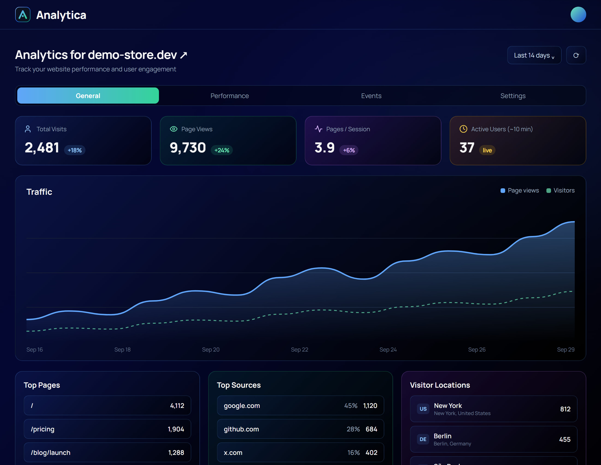
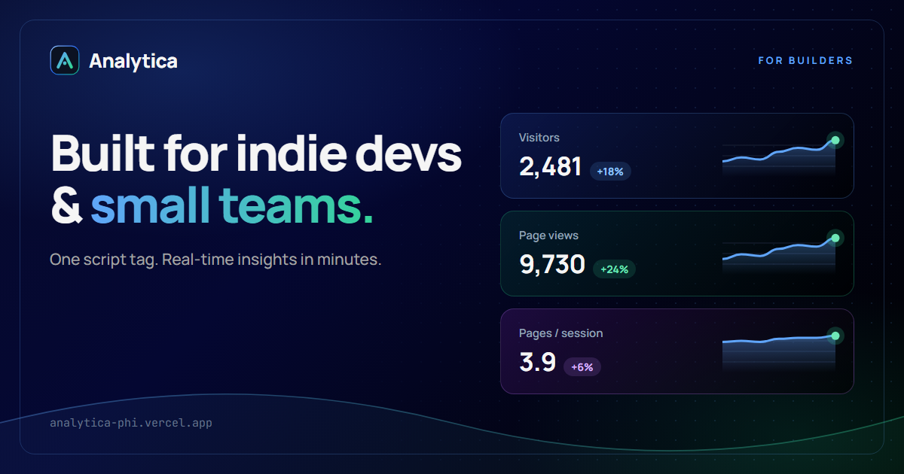
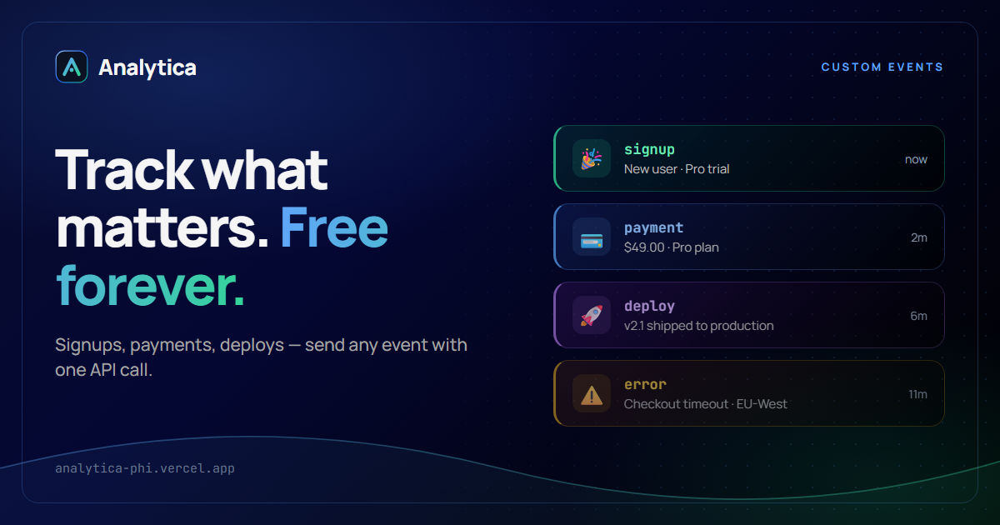
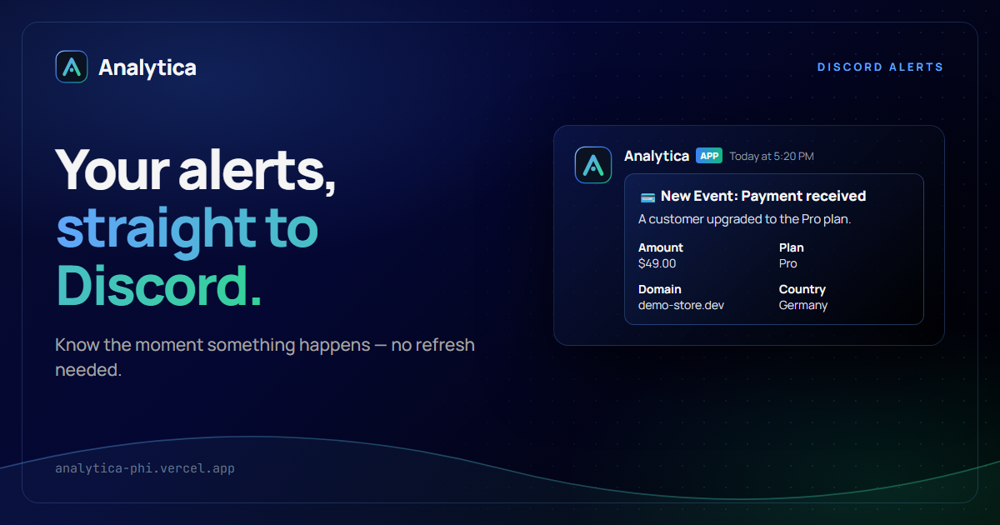

# Analytica

[](https://github.com/Troy2727/analytica/actions/workflows/e2e.yml)
[](https://nextjs.org/)
[](https://react.dev/)
[](https://www.typescriptlang.org/)
[](https://tailwindcss.com/)
[](https://supabase.com/)
[](https://vercel.com/)
[](https://playwright.dev/)
[](https://discord.com/)

Free website analytics you install with one script tag. Analytica records page views, visits, traffic sources,
locations, devices and browsers, runs Google PageSpeed on your site, and DMs you on Discord when your backend
sends a custom event.

**Live:** [analytica-phi.vercel.app](https://analytica-phi.vercel.app)



##  Try the demo

Sign in at [analytica-phi.vercel.app/sign-in](https://analytica-phi.vercel.app/sign-in) with:

| Email | Password |
|---|---|
| `demo@example.com` | `AnalyticaDemo2026!` |

The demo account tracks Analytica's own site, so it shows real traffic, events and PageSpeed scores. It can't
change its password, Discord ID or demo website.

##  Features



- **Traffic:** visits, page views, pages per session, people on the site in the last 10 minutes, and a chart by
  hour or day for any timeframe from the last hour to lifetime.
- **Breakdowns:** top pages, traffic sources (`?utm=` / `?ref=`), countries and cities, operating systems, device
  types and browsers.
- **Custom events:** send any event from your backend with one HTTP request and browse them per event name.
- **Discord alerts:** each custom event can arrive as a Discord DM from Analytica Bot.
- **Performance:** Lighthouse scores (performance, accessibility, best practices, SEO) and lab timings from the
  PageSpeed API, with suggestions for anything below Google's thresholds.
- **Export:** download page views, visits and events as CSV.

##  Install the tracking script

Add it to every page you want to track, with your domain exactly as you added it on the dashboard (no
`https://`, no `www`):

```html
<script defer data-domain="example.com" src="https://analytica-phi.vercel.app/tracking-script.js"></script>
```

In Next.js, use `next/script` in `app/layout.tsx`:

```tsx
import Script from "next/script";

<Script defer data-domain="example.com" src="https://analytica-phi.vercel.app/tracking-script.js" />
```

The script sends a `session_start` when a visitor's session begins (sessions last 10 minutes), a `pageview` on
load and on every client-side navigation, and keeps nothing in the browser except a random session ID.

<p align="center">
  <a href="https://github.com/Troy2727/analytica/blob/main/docs/diagrams/renders/tracking-flow.gif" title="Click to see full size">
    
  </a>
  <br />
  <p align="center"><sub>Click the diagram to see it full size.</sub></p>
</p>

##  Send custom events



Create an API key under **Settings & API Keys**, then `POST` to `/api/events`:

```bash
curl -X POST https://analytica-phi.vercel.app/api/events \
  -H "Authorization: Bearer YOUR_API_KEY" \
  -H "Content-Type: application/json" \
  -d '{
        "name": "new_signup",
        "domain": "example.com",
        "description": "A user signed up",
        "emoji": "🎉",
        "fields": [{ "name": "Plan", "value": "Pro", "inline": true }]
      }'
```

| Field | Required | Notes |
|---|---|---|
| `name` | yes | Events are grouped by name on the dashboard |
| `domain` | yes | Must be one of the websites on your account |
| `description` | yes | The message body |
| `emoji` | no | Shown in the Discord title (default 🔔) |
| `fields` | no | Extra `{ name, value, inline? }` rows in the Discord message |

| Status | Meaning |
|---|---|
| `200` | Recorded. `message` says whether a Discord DM was sent |
| `400` | A required field is empty |
| `401` | No `Authorization: Bearer` header |
| `403` | Unknown API key, or the domain isn't registered to it |

The settings page has the same request as copy-ready JavaScript and Python.

<p align="center">
  <a href="https://github.com/Troy2727/analytica/blob/main/docs/diagrams/renders/custom-events-flow.gif" title="Click to see full size">
    
  </a>
  <br />
  <p align="center"><sub>Click the diagram to see it full size.</sub></p>
</p>

### Discord alerts



1. In Discord, turn on Developer Mode (User Settings → Advanced).
2. Right-click your name, choose **Copy User ID**, and paste it under **Discord Integration** in settings.
3. [Invite Analytica Bot](https://discord.com/oauth2/authorize?client_id=1365847380309704714&scope=bot&permissions=0)
   to any server you're in. Discord only delivers DMs from bots you share a server with.

##  How it works

<p align="center">
  <a href="https://github.com/Troy2727/analytica/blob/main/docs/diagrams/renders/architecture.gif" title="Click to see full size">
    
  </a>
  <br />
  <p align="center"><sub>Click the diagram to see it full size.</sub></p>
</p>

- **Next.js 16 (App Router)** on Vercel serves the dashboard and three API routes:
  `/api/track` (tracking script), `/api/events` (custom events) and `/api/keepalive` (a daily Vercel Cron that
  keeps the free Supabase project awake).
- **Supabase (Postgres + Auth)** stores `users`, `websites`, `page_views`, `visits` and `events`. Row-level
  security limits every dashboard query to the signed-in user's own websites. Requests without a user session
  (API-key events, PageSpeed server actions) use the service role and check ownership in code.
- Visitor location comes from Vercel's geo headers; no IP addresses are stored.

Tracked rows are linked to a website by its domain, not by a foreign key:

<p align="center">
  <a href="https://github.com/Troy2727/analytica/blob/main/docs/diagrams/renders/data-model.gif" title="Click to see full size">
    
  </a>
  <br />
  <p align="center"><sub>Click the diagram to see it full size.</sub></p>
</p>

```
app/                  pages and API routes
  site/[website]/     analytics for one website (tabs live in components/site)
  api/                track, events, keepalive
actions/pagespeed.ts  server actions: run and read PageSpeed results
components/           UI; components/ui holds shadcn/ui and Magic UI primitives
lib/                  Supabase clients, queries, analytics math, formatting, CSV
public/tracking-script.js
supabase/migrations/  schema, RLS policies, demo-account protection
e2e/                  Playwright tests
```

##  Run it locally

You need Node 20+ and a Supabase project.

1. Apply the SQL files in `supabase/migrations/` in order (Supabase SQL editor or `supabase db push`).
2. Create `.env.local`:

   ```bash
   NEXT_PUBLIC_SUPABASE_URL=https://<project>.supabase.co
   NEXT_PUBLIC_SUPABASE_ANON_KEY=<anon key>
   SUPABASE_SERVICE_ROLE_KEY=<service role key>    # server only
   GOOGLE_PAGESPEED_API_KEY=<key>                  # optional, for the Performance tab
   DISCORD_BOT_TOKEN=<token>                       # optional, for event DMs
   ```

3. `npm install` and `npm run dev`, then open http://localhost:3000.

The tracking script always reports to the production API, so point `ENDPOINT` in `public/tracking-script.js` at
your own deployment if you self-host.

##  Testing

[Playwright](https://playwright.dev) end-to-end tests run against the live site on desktop and mobile viewports
after every production deploy ([E2E Tests workflow](https://github.com/Troy2727/analytica/actions/workflows/e2e.yml)):

- **Public pages:** the homepage renders and its own tracking calls are stored, no horizontal scroll on mobile,
  logged-out visitors are redirected to sign-in, wrong passwords show an error, and unknown routes return a 404.
- **API:** tracking rejects mismatched domains and allows cross-origin requests, the events endpoint requires a
  valid API key, and the keepalive route reaches the database.
- **Signed-in flow:** the demo account sees its dashboard, site analytics, custom events, PageSpeed scores and
  settings.

None of the tests write to the database.

```bash
npx playwright install chromium
npm test                                  # against production
BASE_URL=https://<deployment> npm test    # against another deployment
```

The homepage tracking test expects production, since the tracking script always reports to the live API.

##  Credits

UI primitives in `components/ui` come from [shadcn/ui](https://ui.shadcn.com)
and [Magic UI](https://magicui.design).

##  Author

Built and maintained by **Alex Mieses** ([GitHub](https://github.com/Troy2727), [X](https://x.com/AlexMieses27)).

Alex built Analytica as a complete product, not just a tracking script: a one-tag script that follows
client-side navigation, a Next.js 16 dashboard on Vercel backed by Supabase with row-level security, a custom
events API that can DM you on Discord through Analytica Bot, and a Performance tab built on Google PageSpeed.
No visitor IP addresses are stored, and Playwright end-to-end tests check the live site on desktop and mobile
after every production deploy.

Questions and ideas are welcome in [issues](https://github.com/Troy2727/analytica/issues).
